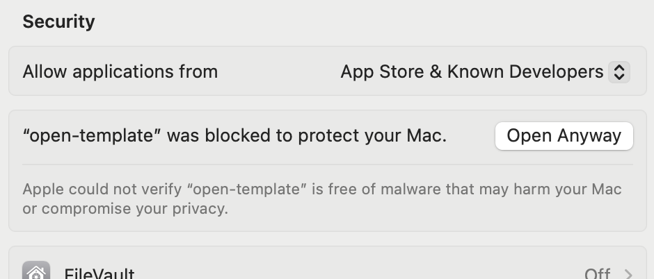

# open-template

A local workspace for building software from written requirements, with an AI agent (**Codex CLI, Gemini CLI, or Claude Code**)

Create or open a project, describe its features, design, architecture, and testing requirements, then run the pipeline to trigger ai agents to comply with the specification.

## Download and install

Open this repository's **Releases** page on GitHub, choose a release, and expand **Assets** to download an installer (rather than the source-code archives).

- **macOS:** download `macos-arm64.dmg` for Apple Silicon or `macos-x64.dmg` for Intel. Open the DMG, drag **open-template** into **Applications**, then launch it.
- **Windows — untested:** download `windows-x64.exe` or `windows-x64.msi`, run the installer, and launch **open-template** from the Start menu. Windows builds are provided for testing; installation and runtime behavior have not been verified on a real Windows machine. Claude's required sandbox currently prevents native Windows execution.

**If macOS blocks the app:** these previews are not notarized by Apple. If you trust the release you downloaded:

1. Try opening **open-template** from Applications.
2. Open **System Settings → Privacy & Security**.
3. Scroll down to the **Security** section.
4. Beside the message **“open-template” was blocked to protect your Mac**, click **Open Anyway**, then confirm.



See [Apple’s instructions](https://support.apple.com/en-gb/102445).

Installers include Node and the provider CLI tools. Choose a provider in **Settings** and sign in. These preview releases are not developer-signed or notarized, so your operating system may warn or block installation. If no release is listed yet, use the development setup below.

## Development setup

Requires Node.js 22.12+, npm, and Git. Desktop development also requires Rust and platform build tools: Xcode command-line tools on macOS; Visual Studio C++ build tools and WebView2 on Windows.

```sh
npm ci
npm run desktop:dev
```

Setup downloads the provider CLI tools. Choose a provider in Settings and sign in with its CLI. Provider access and usage charges depend on your account. Generated projects may need additional development tools.

For browser development, run `npm run dev` and open http://127.0.0.1:4310.

## Build and check

```sh
npm run typecheck
npm run check:architecture
npm test
npm run build
npx playwright install chromium
npm run test:e2e
```

Build an installer with `npm run desktop:build` on the target OS and architecture. Output: `src-tauri/target/release/bundle/`. Signing and bundled-provider redistribution checks remain release tasks.

## GitHub releases

Only updates to `release` trigger GitHub Actions. PRs and pushes to other branches do not run validation checks. Run the checks above locally before merging.

Merge a PR into `release` to publish. The workflow automatically picks the next patch version above existing stable release tags and snapshot branches, using the version in `package.json` as a minimum. No manual version bump is needed.

It creates `releases/<version>` with a version-only commit on top of the merged commit, synchronizing the npm, Tauri and Cargo manifests without writing back to `release`. It then builds Apple Silicon/Intel macOS and Windows x64 installers and publishes downloads with checksums and a `v<version>` tag after every build succeeds. Automated tests, type checking and architecture checks are not run; version and snapshot integrity safeguards remain enforced.

Snapshot branches and tags have no deployment trigger. Existing snapshots are never overwritten; retrying the same workflow run reuses its assigned version and commit. Failed snapshots reserve their version numbers. For an intentional major/minor jump or prerelease, use `npm run release:version -- 0.2.0` (or `0.2.0-beta.1`) before merging; occupied prerelease numbers advance automatically. GitHub's automatic token is used; no personal access token is needed.

Initial downloads are unsigned (ad-hoc signed on macOS), not notarized, and may trigger OS security warnings. Signing and provider redistribution checks remain release tasks. This publishes downloads; it does not auto-update installed apps.

## Local data

Projects stay in your chosen folder; `.project-studio/` holds their definitions and history. No default project is created.

Desktop info: `~/Library/Application Support/open-template` on macOS or `%APPDATA%\open-template` on Windows.

## License

Copyright (c) 2026 open-template contributors. Licensed under [GPLv3](LICENSE), without warranty. Third-party dependencies and provider tools retain their own licenses and terms.
